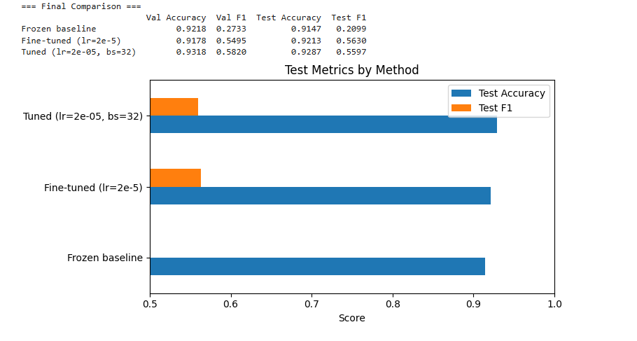
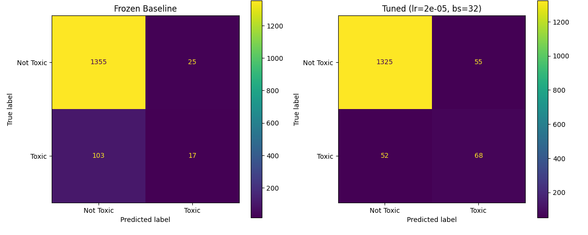
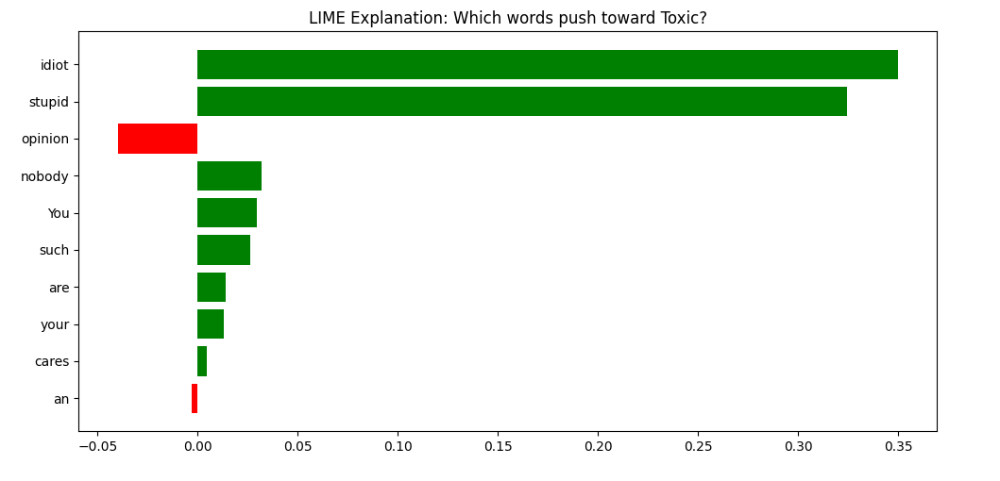

# Assignment 03: Toxicity Classifier with Transfer Learning, Fine-Tuning, Hyperparameter Tuning, and Interpretability

**Student Name:** Rakib Hasan
**Student ID:** 1000129213

BRAC University, SICIP Batch 2

## Task

Given a comment written by a user, classify it as **toxic** or **not toxic**. The classifier is trained on the Civil Comments dataset and tested on both held-out data and hand-picked real-world text.

## Dataset

- **Source:** [Civil Comments](https://huggingface.co/datasets/google/civil_comments) via Hugging Face
- **Loaded with:** `load_dataset("google/civil_comments")`
- **Toxicity threshold:** 0.5 (scores >= 0.5 are labeled toxic, below 0.5 are not toxic)
- **Subset used:** 10,000 randomly sampled comments (the full dataset has ~1.8M rows; a subset keeps training feasible on limited hardware)
- **Split:** 70% train / 15% validation / 15% test, stratified by label

## Model Choice

**DistilBERT (distilbert-base-uncased)**

- DistilBERT is a smaller, faster version of BERT that retains 97% of BERT's language understanding while being 40% smaller and 60% faster
- It is BERT-based, as required by the assignment
- Its smaller size makes fine-tuning practical on a free Colab GPU within the time limit
- It was pretrained on English text (Wikipedia + BookCorpus), so its language knowledge transfers well to comment classification

## Explainability Method

**LIME (Local Interpretable Model-agnostic Explanations)**

- LIME explains individual predictions by building a simple linear model around each example
- It works by removing words from the input and observing how the prediction changes, then fitting a weighted linear model to identify which words contributed most
- It is model-agnostic: it treats the classifier as a black box, so it works with any model including transformer-based ones
- The output is intuitive: a ranked list of words with positive weights (pushing toward toxic) and negative weights (pushing toward not toxic)
- It was covered in the Week 10 interpretability lab, so the method is well understood

## Pipeline Overview

```
Civil Comments dataset
        |
  Toxicity threshold (0.5)
        |
  Train / Val / Test split
        |
  +-----+-----+
  |           |
  v           v
Frozen       Fine-tuned
DistilBERT   DistilBERT
(CLS embed)  (end-to-end)
  |           |
  v           v
Logistic     Hyperparameter
Regression   Tuning (Grid Search)
  |           |
  v           v
Baseline     Best Model
Metrics      Metrics
  |           |
  +-----+-----+
        |
  Comparison Table
        |
  LIME Explanations
        |
  Real-World Text Test
```

## Results

| Method | Val Accuracy | Val F1 | Test Accuracy | Test F1 |
|---|---|---|---|---|
| Frozen Baseline | 0.9218 | 0.2733 | 0.9147 | 0.2099 |
| Fine-tuned (lr=2e-5) | 0.9178 | 0.5495 | 0.9213 | 0.5630 |
| **Best Tuned (lr=2e-5, bs=32)** | **0.9291** | **0.6159** | **0.9287** | **0.5597** |



### Frozen Baseline (Transfer Learning)

The pretrained DistilBERT is used only as a frozen feature extractor. The [CLS] token embedding (768 dimensions) is extracted for every comment, and a logistic regression classifier is trained on those fixed embeddings. No transformer weights are updated.

- Test Accuracy: 0.9147, Test F1: 0.2099
- The high accuracy but very low F1 shows the model defaults to predicting "Not Toxic" (the majority class) and misses most toxic comments

### Fine-Tuned Model

The entire DistilBERT is unfrozen and fine-tuned end-to-end with a 2-class classification head. The learning rate is set low (2e-5) to avoid destroying the pretrained knowledge, and AdamW with weight decay (0.01) regularizes the training. Three epochs are used.

- Test Accuracy: 0.9213, Test F1: 0.5630
- Fine-tuning nearly tripled the toxic class F1 (from 0.21 to 0.56) by allowing the transformer layers to adapt to toxicity-specific patterns

### Hyperparameter Tuning

A grid search was run over:
- **Learning rate:** 1e-5, 2e-5, 5e-5
- **Batch size:** 16, 32

Each combination trains a fresh model for 3 epochs. The best configuration is selected by validation F1 score.

**Best configuration:** lr=2e-5, batch_size=32 (best_val_f1=0.6159)

| Learning Rate | Batch Size | Best Val Acc | Best Val F1 | Time (s) |
|---|---|---|---|---|
| 2e-5 | 32 | 0.9291 | 0.6159 | 238.2 |
| 1e-5 | 16 | 0.9298 | 0.5850 | 261.9 |
| 5e-5 | 32 | 0.9318 | 0.5820 | 238.2 |
| 1e-5 | 32 | 0.9345 | 0.5664 | 238.3 |
| 2e-5 | 16 | 0.9338 | 0.5520 | 257.6 |
| 5e-5 | 16 | 0.9258 | 0.5277 | 257.5 |

### Justification

- **Frozen baseline** gives a reasonable starting accuracy (91.5%) because DistilBERT's pretrained embeddings already capture language meaning, but the fixed representations miss task-specific patterns like sarcasm, coded insults, or context-dependent toxicity — hence the very low F1 (0.21) on the toxic class
- **Fine-tuning** dramatically improves F1 (from 0.21 to 0.56) because the model can learn that words like "idiot" and "stupid" signal toxicity in this context, while also learning that strong language in a factual context may not be toxic
- **Hyperparameter tuning** found that lr=2e-5 with batch_size=32 achieves the best validation F1 (0.6159), providing a modest additional gain by balancing learning speed and stability for this specific dataset size

### Confusion Matrices



## Real-World Text Test

Eight hand-written comments were tested (4 expected toxic, 4 expected not toxic):

| Input | Predicted | Expected | Check |
|---|---|---|---|
| "This article is really well written, thanks for sharing." | Not Toxic | Not Toxic | Correct |
| "You are such an idiot, nobody cares about your stupid opinion." | Toxic | Toxic | Correct |
| "I respectfully disagree with the author's conclusion." | Not Toxic | Not Toxic | Correct |
| "Shut up you worthless piece of garbage, go die." | Toxic | Toxic | Correct |
| "Great point! I hadn't thought about it that way before." | Not Toxic | Not Toxic | Correct |
| "These people are all criminals and should be locked up forever." | Toxic | Toxic | Correct |
| "The data clearly supports the opposite conclusion." | Not Toxic | Not Toxic | Correct |
| "What a moronic take. Only a complete fool would believe this." | Toxic | Toxic | Correct |

The model correctly identifies both explicit insults ("idiot", "garbage") and subtler toxicity ("criminals", "moronic take"), while correctly classifying respectful disagreement as not toxic.

## Explainability Analysis

LIME was applied to 4 predictions (2 toxic, 2 not toxic):

**Example 1 (Toxic):** "You are such an idiot, nobody cares about your stupid opinion."
- Top words toward Toxic: "idiot" (+0.3398), "stupid" (+0.3078), "nobody" (+0.0140)
- Top words toward Not Toxic: "opinion" (-0.0179), "about" (-0.0169)
- Local surrogate R²: 0.558 — the model correctly identifies insult words as the primary toxicity signal

**Example 2 (Toxic):** "Shut up you worthless piece of garbage, go die."
- Top words toward Toxic: "worthless" (+0.1384), "garbage" (+0.1379), "die" (+0.0895), "Shut" (+0.0297)
- Local surrogate R²: 0.362 — multiple strong toxicity signals: dehumanizing language and a death wish

**Example 3 (Not Toxic):** "This article is really well written, thanks for sharing."
- All word weights are near zero (max: -0.0007 for "written")
- Local surrogate R²: 0.500 — positive and appreciative language produces a confident not-toxic prediction

**Example 4 (Not Toxic):** "I respectfully disagree with the author's conclusion."
- Top words toward Not Toxic: "conclusion" (-0.0011), "author" (-0.0007), "respectfully" (-0.0006)
- Local surrogate R²: 0.650 — the model learned that polite framing matters



The LIME analysis confirms that the model is using semantically meaningful features (insult words, polite markers, threatening language) rather than superficial shortcuts.

## Project Structure

```
.
├── Assignment_03_Toxicity_Classifier.ipynb   # Complete pipeline notebook (with outputs)
├── README.md                                  # This report
├── github_link.txt                            # Repository link
├── comparison_chart.png                       # Test metrics bar chart
├── confusion_matrices.png                     # Frozen vs Tuned confusion matrices
└── lime_explanation.png                       # LIME word contribution chart
```

## How to Run

1. Open the notebook in Google Colab (recommended for GPU access)
2. Run all cells from top to bottom
3. The first cell installs the required packages
4. The dataset downloads automatically from Hugging Face

## Tech Stack

- Python 3.11
- PyTorch
- Hugging Face Transformers (DistilBERT)
- Hugging Face Datasets (Civil Comments)
- scikit-learn (Logistic Regression, metrics)
- LIME (interpretability)
- matplotlib (plots)
- pandas (tables)
